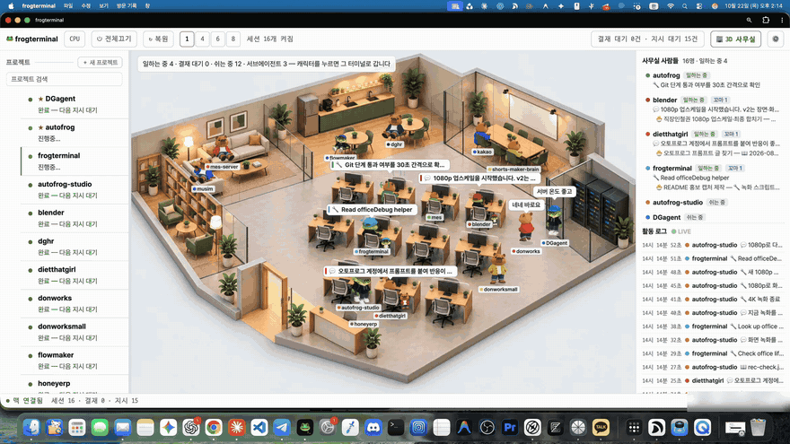
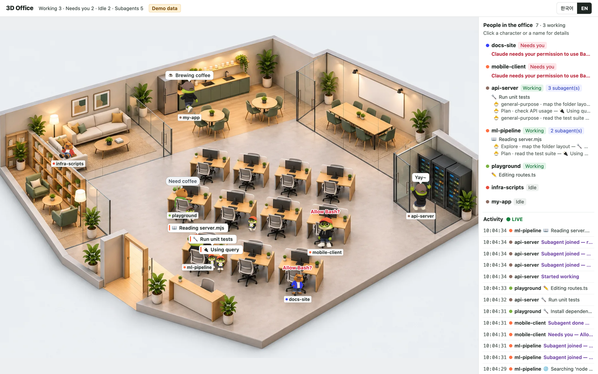
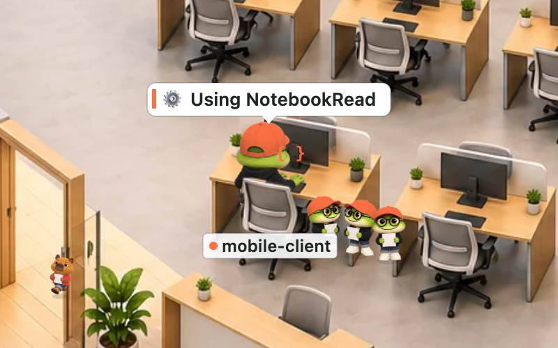
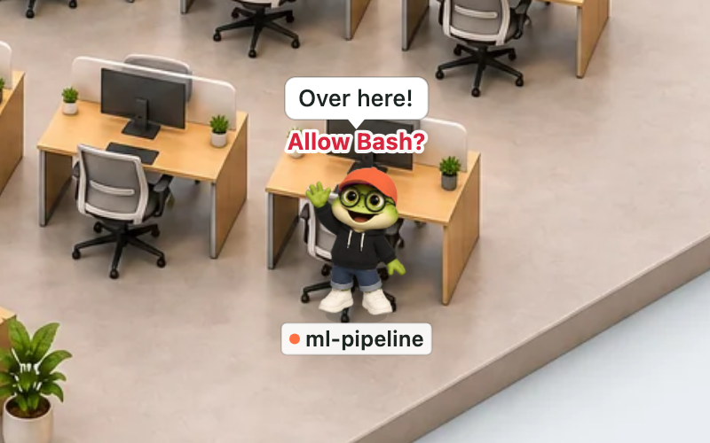
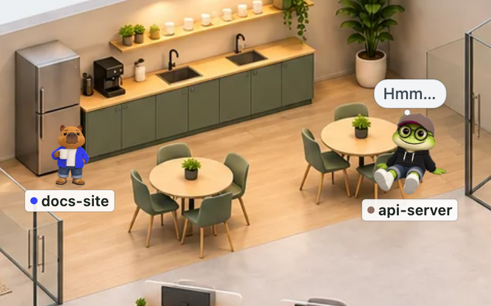
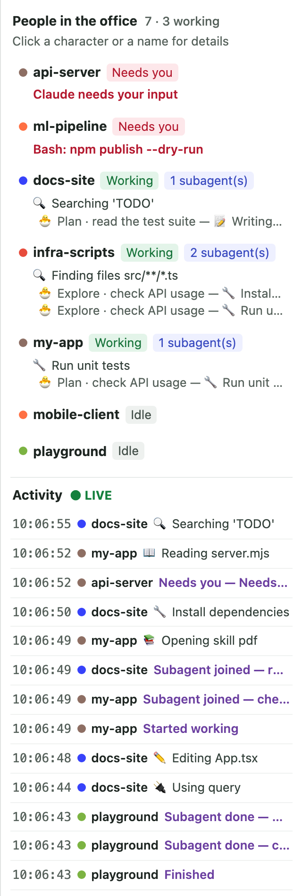

<h1 align="center">🐸 Claude 3D Frog Office</h1>

<p align="center"><b>Running several Claude Code sessions at once? Stop clicking through terminals to check on them.<br>
One office scene shows who is working, who is taking a break, and who is waiting on you.</b></p>

<p align="center">
  <a href="README.md">한국어</a> · <b>English</b><br>
  
  
  
  
</p>

<p align="center">
  <a href="https://raw.githubusercontent.com/d-onworks/claude-3d-frog-office/master/docs/video/promo-ko.mp4"></a><br>
  <sub>Click to download the 16-second promo video with sound (mp4, Korean captions) · made by AutoFrog Studio · recorded in our in-house terminal app</sub>
</p>

## The more sessions you open, the more you miss

With just three or four Claude Code sessions open, this starts to happen:

- You come back to a window and find Claude has been stuck on "Can I run this command?" for ten minutes.
- You can't tell which sessions are still working and which are done, so you click through them one by one.
- You can't see how many subagents are running or which files they are reading and editing right now.

Claude 3D Frog Office turns all of that into a single office scene. Each running project is one character. Characters that are working type at their desks. A character that needs your answer stands up and hops. Keep one browser tab open next to your editor and you're set.

## Setup is one sentence to Claude

All you need is [Claude Code](https://code.claude.com/docs/en/overview) and Node.js 18+. No `npm install`.

```bash
git clone https://github.com/d-onworks/claude-3d-frog-office.git
cd claude-3d-frog-office
claude
```

Then tell Claude:

```
Set up the 3D office
```

Claude reads this repo's `CLAUDE.md`, backs up your settings, adds the hooks, starts the local server and opens `http://127.0.0.1:4777` in your browser. Bookmark it. Prefer doing it yourself? `node scripts/setup.mjs` does the same thing.

Want a look before installing anything? Run `npm run demo` to see the office running on fake data.

## What you see

<p align="center"></p>

<table>
<tr>
<td width="50%"></td>
<td width="50%"></td>
</tr>
<tr>
<td><b>Working</b><br>The character types at its desk with its real current action overhead ("📖 Reading server.mjs"). Subagents show up as small characters in the same color, lined up next to their owner.</td>
<td><b>Needs you</b><br>When Claude is waiting for a tool permission or an answer, the character gets up and hops with a red label. You can spot it from across the room.</td>
</tr>
<tr>
<td></td>
<td></td>
</tr>
<tr>
<td><b>Idle</b><br>Once a task is done, characters head to the sofa, the pantry or the meeting room for coffee, small talk or a bit of phone scrolling.</td>
<td><b>Activity log</b><br>The side panel streams everyone's status and recent actions. Click a character to focus on that project.</td>
</tr>
</table>

## Office life handbook

The staff work harder than you'd expect, and slack off better than you'd expect.

- **They commute through the door.** Open a session and an employee walks in and finds a free desk. Close it and they walk back out. No overtime pay.
- **They mean business.** They type with their shoulders bouncing and show what they're doing above their head, like "📖 reading server.mjs".
- **They hop when they need you.** An employee waiting for approval stands up and hops around with red text. Hard to ignore.
- **Subagents are little interns.** Kids in the same color cap line up next to their owner, then say goodbye and leave when the job is done.
- **Breaks are taken seriously.** They giggle at their phones on the sofa, brew coffee in the pantry, and gather in the meeting room for important agenda items like lunch.
- **They talk to themselves, and to each other.** "Leave on time today?" "Merge conflict…" If that sounds familiar, it's just your imagination.
- **They wave when they pass each other in the hallway.** Great company culture.
- **New hires start small.** A repository with fewer than 50 commits shows up as a kid employee and grows up as the commits pile up.
- Several sessions opened in the same repository merge into one employee. Projects you pick in the config work standing at the server racks. Switch between 한국어 and English at the top right.

## Why we share it

> Downloading the same code instead of rebuilding it saves electricity and helps protect the environment. That is why we share it.

When everyone asks an AI to build the same tool from scratch, that is a lot of GPU time and a lot of power. This one is already built and tested on macOS and Windows. Take it as it is, and if you improve it, share it back.

## Works on macOS and Windows

| Platform | What we checked |
|---|---|
| macOS | Tested with the real Claude Code: session start, working, needs-you, back to idle after approval, Esc interrupt, subagents and session end all show up on screen |
| Windows | Ran the hook commands through all three shells: Git Bash, PowerShell and cmd |
| Linux | Built to work the same way, but not tested by us yet |

It doesn't care about your editor either. Run Claude Code in the VS Code, Cursor or JetBrains terminal, iTerm or Windows Terminal; anywhere works.

## Light, and nothing leaves your machine

- It uses only the Node.js standard library. There are no packages to download.
- Hooks fire only at a few moments: session start, prompt submitted, permission request, stop and session end. They do not run on every tool call, so Claude stays fast.
- The server listens on `127.0.0.1` only and checks the Host header so other websites can't read it (DNS rebinding protection). No external servers, CDNs or analytics.
- Setup backs up `settings.json` first (`settings.json.bak-office-…`) and only adds its own hooks. Your existing hooks are left alone, and uninstall removes only the hooks this repo added.
- The page shows tool names, file names and command descriptions (the Bash `description`) taken from your transcripts. Keep that in mind when screen sharing.

## How it works

```
Claude Code ──hooks──▶ hooks/office-hook.mjs ──▶ ~/.claude-office/sessions/<session>.json
browser ◀──every 3s── local server (127.0.0.1) ──▶ session cards + tail of transcripts in ~/.claude/projects
```

1. [Claude Code hooks](https://code.claude.com/docs/en/hooks) call a tiny script at those moments, and the script writes one small card file per session.
2. The local server reads the cards plus only the last part of each transcript (jsonl) to work out who is doing what. Subagents are counted from the `subagents/` folder next to the transcript.
3. Sessions opened in the same folder (the repository root, for git repos) merge into one character.

| Claude state | Signal | Character |
|---|---|---|
| Working | prompt received and not finished yet, or a subagent is running | sits at the desk typing, current action above its head |
| Needs you | permission / input notification | hops in front of the desk with a red label |
| Idle | finished (Stop) or interrupted with Esc | relaxes on the sofa, in the pantry or meeting room |
| Gone | session ended, or the Claude process disappeared | walks out the door |

## FAQ

**Do sessions I opened before setup show up?**
Yes, they are picked up from their transcripts. They don't know about the new hooks yet, though, so approval requests can't be detected for them. Restart them once (`/exit`, then `claude --continue`) for full accuracy.

**Does clicking a character jump to its terminal?**
No. It is view-only. Clicking shows that project's details in the side panel and never controls your terminal. The promo scene where a click opens the terminal comes from our in-house terminal app (FrogTerminal), where this office was born.

**My frog has been on the sofa all day.**
You haven't given it any work. Give Claude a task and it goes straight back to its desk.

**Do I have to restart the server after a reboot?**
No. If the server isn't running when a Claude session starts, the hook starts it in the background (`autoStart`). Just open your bookmark.

## Configuration

`~/.claude-office/config.json` (optional):

```json
{
  "port": 4777,
  "autoStart": true,
  "homes": { "my-main-project": "server" },
  "hide": ["scratch"],
  "fallbackMinutes": 20,
  "staleHours": 6,
  "kidCommits": 50,
  "lang": "auto"
}
```

| Key | Meaning |
|---|---|
| `port` | Server port. The `CLAUDE_OFFICE_PORT` environment variable wins |
| `autoStart` | If the server is not running when a Claude session starts, start it in the background |
| `homes` | These projects work standing in front of the server rack |
| `hide` | Projects (folder name or path) to keep out of the office |
| `fallbackMinutes` | For sessions without hooks: how recent a transcript must be to show up |
| `staleHours` | Sessions whose process can't be checked leave after this many quiet hours |
| `kidCommits` | Fewer commits than this means a smaller character |
| `lang` | `auto`, `ko` or `en`. You can also switch with the button at the top right |

## Commands

| Command | What it does |
|---|---|
| `node scripts/setup.mjs` | install hooks, start the server, open the browser |
| `node scripts/start.mjs --open` | start the server and open the browser |
| `node scripts/stop.mjs` | stop the server |
| `node scripts/status.mjs` | check hooks, server and detected sessions |
| `node scripts/uninstall.mjs` | remove only this repo's hooks and stop the server (`--purge` also deletes `~/.claude-office`) |
| `npm run demo` | preview with fake data |
| `npm test` | run the tests |

## Uninstall

```bash
node scripts/uninstall.mjs
```

This removes only the hooks this repo added. Then delete the folder.

## License and notice

MIT. The characters and the office art were made with AI image generation tools and then edited by hand.

This project is not made or endorsed by Anthropic. Claude is a trademark of Anthropic. The code is provided as is, and you use it at your own risk.
