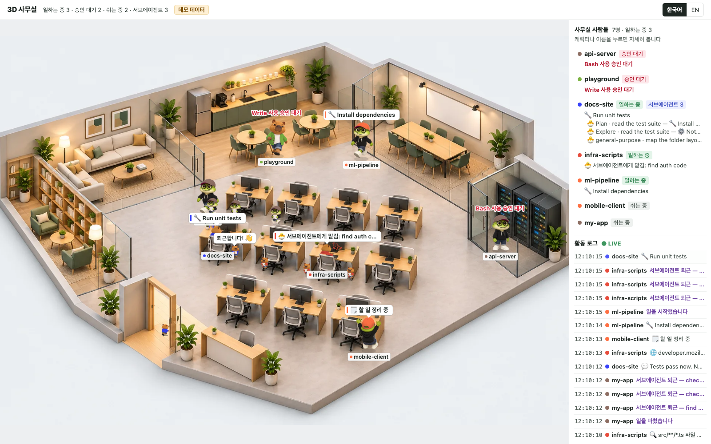

# 3D 사무실 (claude-3d-office)

[English](README.en.md)

Claude Code 세션을 여러 개 열어 두고 일할 때, 각 프로젝트가 지금 무엇을 하는지 한 화면에서 보여 주는 로컬 웹 페이지입니다.
켜져 있는 프로젝트 하나가 사무실 캐릭터(개구리 또는 카피바라) 하나가 됩니다.



- Claude 가 일하는 중이면 캐릭터가 자기 책상에 앉아 코딩하고, 머리 위에 실제로 하는 일("📖 server.mjs 읽는 중")이 뜹니다.
- 승인이 필요하면(도구 사용 허락 등) 캐릭터가 일어나 빨간 글씨로 폴짝거립니다.
- 쉬는 동안에는 소파·탕비실·회의실에서 커피를 마시거나 수다를 떨거나 휴대폰을 봅니다.
- 서브에이전트를 띄우면 같은 색의 작은 캐릭터가 옆에 줄을 섰다가, 일이 끝나면 인사하고 퇴근합니다.
- 오른쪽 패널에 사람별 상태와 활동 로그가 실시간으로 흐릅니다.

보기 전용입니다. 캐릭터를 누르면 오른쪽 패널에서 그 프로젝트의 자세한 정보를 보여 줄 뿐, 터미널을 조작하지 않습니다.
VS Code, Cursor, JetBrains, iTerm, Windows Terminal 등 Claude Code 를 어디서 실행하든 똑같이 동작합니다.

## 빠른 시작

필요한 것: [Claude Code](https://code.claude.com/docs/en/overview), Node.js 18 이상. 그 밖의 설치(npm install 등)는 없습니다.

```bash
git clone https://github.com/<you>/claude-3d-office.git
cd claude-3d-office
claude
```

Claude 에게 이렇게 말하면 됩니다.

```
3D 사무실 적용해줘
```

Claude 가 저장소의 `CLAUDE.md` 를 읽고 훅 설치, 서버 실행, 브라우저 열기까지 해 줍니다. 직접 하려면:

```bash
node scripts/setup.mjs
```

브라우저에서 `http://127.0.0.1:4777` 이 열립니다. 북마크해 두세요.

> 설치 전에 이미 열려 있던 Claude 세션은 새 훅을 모릅니다. 그런 세션도 대화 기록만으로 화면에 나타나지만 승인 대기는 잡히지 않습니다.
> 세션을 한 번 다시 시작하면(`/exit` 후 `claude --continue`) 정확하게 표시됩니다.

실제 세션 없이 화면만 먼저 보고 싶다면 `npm run demo` 를 실행하세요(가짜 데이터, 포트 4778).

## 어떻게 동작하나

```
Claude Code ──훅──▶ hooks/office-hook.mjs ──▶ ~/.claude-office/sessions/<세션>.json
브라우저 ◀──3초마다── 로컬 서버(127.0.0.1) ──▶ 세션 카드 + ~/.claude/projects 의 대화 기록 끝부분
```

1. [Claude Code 훅](https://code.claude.com/docs/en/hooks)이 세션이 시작·질문 받음·승인 요청·끝남 같은 순간마다 작은 스크립트를 부릅니다.
   스크립트는 세션마다 카드 파일 하나를 씁니다. 매 도구 호출마다 불리지 않으므로 Claude 작업 속도에 영향이 거의 없습니다.
2. 로컬 서버가 카드와 대화 기록(jsonl)의 끝부분만 읽어 "누가 무엇을 하는지"를 만듭니다. 서브에이전트는 대화 기록 옆의 `subagents/` 폴더로 셉니다.
3. 같은 폴더(git 저장소면 저장소 최상위)에서 연 세션들은 캐릭터 한 명으로 합쳐집니다. 커밋이 50개 미만인 저장소는 작은 캐릭터로 나옵니다.

### 상태와 캐릭터

| Claude 상태 | 판단 근거 | 캐릭터 |
|---|---|---|
| 일하는 중 | 질문을 받은 뒤 아직 답을 끝내지 않음, 또는 서브에이전트가 일하는 중 | 책상에 앉아 코딩, 머리 위에 하는 일 |
| 승인 대기 | 권한 요청·입력 요청 알림 | 책상 앞에서 빨간 글씨로 폴짝 |
| 쉬는 중 | 답을 끝냄(Stop), Esc 로 끊음 | 소파·탕비실·회의실에서 쉼 |
| 사라짐 | 세션 종료, 또는 Claude 프로세스가 없어짐 | 문으로 퇴근 |

## 설정

`~/.claude-office/config.json` (없으면 기본값):

```json
{
  "port": 4777,
  "autoStart": true,
  "homes": { "my-main-project": "server" },
  "hide": ["scratch"],
  "fallbackMinutes": 20,
  "staleHours": 6,
  "kidCommits": 50,
  "lang": "auto"
}
```

| 키 | 뜻 |
|---|---|
| `port` | 서버 포트. 환경변수 `CLAUDE_OFFICE_PORT` 가 우선합니다 |
| `autoStart` | Claude 세션이 시작될 때 서버가 꺼져 있으면 자동으로 띄웁니다. 재부팅 뒤에도 따로 켤 필요가 없습니다 |
| `homes` | 지정한 프로젝트는 서버실 랙 앞에 서서 일합니다 |
| `hide` | 사무실에 띄우지 않을 프로젝트(폴더 이름 또는 경로) |
| `fallbackMinutes` | 훅이 없는 세션을 대화 기록으로 찾을 때, 최근 몇 분 안에 바뀐 기록까지 볼지 |
| `staleHours` | 프로세스를 확인할 수 없는 세션을 몇 시간 조용하면 퇴근시킬지 |
| `kidCommits` | 이보다 커밋이 적으면 작은 캐릭터 |
| `lang` | `auto`·`ko`·`en`. 화면 오른쪽 위 버튼으로도 바꿀 수 있습니다 |

## 명령

| 명령 | 하는 일 |
|---|---|
| `node scripts/setup.mjs` | 훅 설치 + 서버 실행 + 브라우저 열기 |
| `node scripts/start.mjs --open` | 서버 실행 후 브라우저 열기 |
| `node scripts/stop.mjs` | 서버 끄기 |
| `node scripts/status.mjs` | 훅 설치 여부, 서버 상태, 잡힌 세션 수 확인 |
| `node scripts/uninstall.mjs` | 이 저장소가 넣은 훅만 지우고 서버 끄기 (`--purge` 면 `~/.claude-office` 도 삭제) |
| `npm run demo` | 가짜 데이터로 화면 미리보기 |
| `npm test` | 시험 |

## 개인정보와 보안

- 서버는 `127.0.0.1` 에만 열리고, Host 헤더를 확인해 다른 웹사이트가 이 서버를 읽어 가지 못하게 막습니다.
- 데이터는 컴퓨터 밖으로 나가지 않습니다. 외부 서버·CDN·분석 도구를 쓰지 않습니다.
- 화면에는 대화 기록에서 뽑은 도구 이름, 파일 이름, 명령 설명(Bash 의 description)이 보입니다. 화면을 공유할 때는 이 점을 참고하세요.
- 설치 스크립트는 `settings.json` 을 바꾸기 전에 백업(`settings.json.bak-office-…`)을 만들고, 기존 훅은 건드리지 않습니다.

## 제거

```bash
node scripts/uninstall.mjs
```

이 저장소가 넣은 훅만 지웁니다. 그다음 폴더를 지우면 끝입니다.

## 라이선스

MIT. 캐릭터와 사무실 그림은 AI 이미지 생성 도구로 만든 뒤 손질했습니다.
